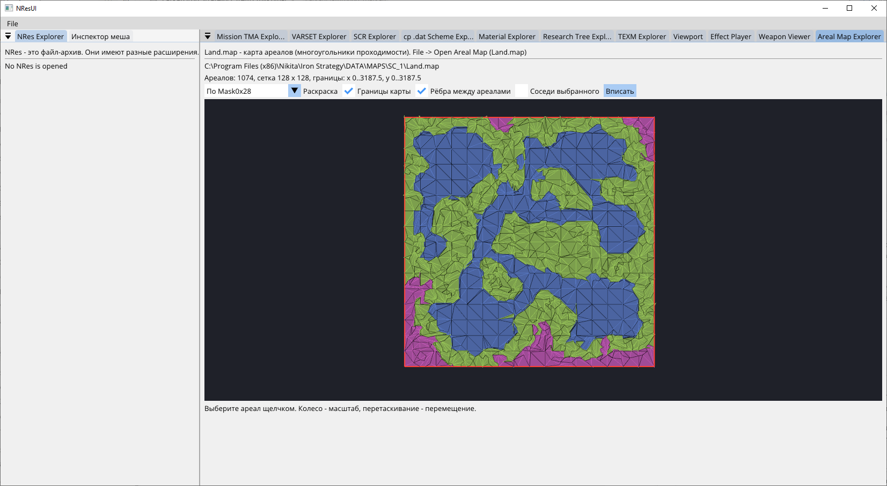

# ArealMapLib: карта ареалов (`Land.map`)

*Areal Map Explorer: карта `SC_1`, раскраска по `Mask0x28`; красным - границы карты*

`Land.map` - NRes-архив (см. [NResLib](../NResLib/README.md)) с одной записью `ArealMap` типа `0x0C`; лежит в `DATA/MAPS/<карта>/`. Игра читает её в
`ArealMap.dll` (`SystemArealMap::Load`, 0x1001EA60) и строит по ней граф проходимости и поиск путей. Парсер: `ArealMapParser.ReadFile` → `ArealMapFile`.

## Запись `ArealMap`

`ElementCount` записи в каталоге NRes - число ареалов `N`. Содержимое:

| Часть | Размер | Что внутри |
|---|---|---|
| `N` ареалов | переменный | заголовок 0x38 байт, `V` вершин по 12 байт, `V` рёбер по 8 байт |
| ширина и высота сетки | 2 x int32 | во всех картах 128 x 128 |
| ячейки | переменный | для `x` от 0 до ширины, для `y` от 0 до высоты: `uint16 n` и `n` индексов ареалов (`uint16`), пересекающих ячейку |

Заголовок ареала (`ArealRecord`):

| Смещение | Поле | Значения |
|---|---|---|
| +0x00 | центр (x, y, z) | float |
| +0x0C | - | всегда 0 |
| +0x10 | площадь | float; совпадает с площадью многоугольника по вершинам (1945.5 у однотипных треугольников) |
| +0x14 | нормаль (x, y, z) | единичный вектор |
| +0x20 | `IsWalkable` (`Flag0x20`) | 0 или 1 (1 у 5396 из 30951): ареал проходим для наземных юнитов (`LogStatistics` - «Walkable Areals»; `MWalker::SetTarget`) |
| +0x24 | - | всегда 0 |
| +0x28 | `Mask0x28` | 1..29, 240, 242 - похоже на битовую маску свойств; ареалы со значением 3 содержат внешние границы карты |
| +0x2C | - | всегда 0 |
| +0x30 | число вершин `V` | 3 и больше (3 у половины ареалов); около 30% многоугольников не выпуклые, у выпуклых обход против часовой стрелки |
| +0x34 | число связей `L` | всегда 0; игра читает при `L > 0` ещё блоки связей (формат не разобран, парсер отказывается) |

Ребро `i` - отрезок от вершины `i` до вершины `(i + 1) % V`; запись ребра - индекс соседнего ареала и номер ребра в соседнем ареале (или `-1, -1` у границы
карты). Связь симметрична: у соседа то же ребро записано в обратном направлении.

## Что проверено

Статистика по `DATA/MAPS/*/Land.map` первой части (29 карт, 30951 ареал, от 303 до 4990 в карте; команда
`dotnet run --project ParkanPlayground -- areal-map-check <DATA/MAPS>`):

- запись целиком использована: ареалы, затем сетка, размер совпадает с `FileLength` во всех картах;
- индексы в ячейках не выходят за число ареалов;
- все рёбра с соседом симметричны (0 нарушений), геометрически ребро соседа - тот же отрезок в обратном направлении (6420 из 6420 в карте 11);
- поля +0x0C, +0x24, +0x2C и число связей всегда 0.

## Как игра ищет ареал по точке (`SystemArealMap::GetCoverArealID`, `ArealMap.dll` 0x10020DD0)

1. Точка (x, y) переводится в ячейку: `cx = round((x - minX) * cellsPerUnitX - 0.5)`, `cy` - так же по Y; границы мира и число ячеек на единицу хранятся в `SystemArealMap`.
   Данные файла согласуются с размером ячейки «протяжённость карты / 128»: во всех проверенных картах (10 из 29) индексы в ячейках соответствуют ареалам, пересекающим ячейку, с отклонением не больше 1/8 ячейки.
2. Значение ячейки в памяти - 32 бита: младшие 22 бита - начало списка в общем массиве `uint16`, старшие 10 бит - число ареалов в ячейке (при загрузке из «счётчика + индексов» файла).
3. Если в ячейке один ареал - он и есть ответ (без проверки по многоугольнику); иначе перебираются ареалы ячейки и берётся первый, внутри которого лежит точка.
4. Нет ареала: в лог пишутся «point is not inside any Areal», «Hole in ArealGeometry» и т. п.; для точек вне карты результат -1.

## Что ещё известно из кода `ArealMap.dll`

- Игра хранит отдельно от геометрии: тактические ареалы (`SetTacticArealNum`, `SetTacticArealVertexNum`: число и вершины), места миграции кланов
  (`CreateMigrationArealsForClan`, `TryMigrateClan`: по клану список ареалов, из которого случайно выбирается место), типы кланов по умолчанию - 3 (нейтральный).
  Эти данные приходят из миссии (`.tma`), а не из `Land.map`.
- Отладочная отрисовка (`SystemArealMap::show_areals`) красит ареал **зелёным при `Flag0x20 != 0`, иначе красным**. Для ареалов с тактическими данными рисуются линии тактики.
- **Использование `Flag0x20` (проходимость)**: `SystemArealMap::LogStatistics` выводит отдельную статистику «Walkable Areals» по ареалам с `Flag0x20 != 0`;
  `BuildArealApexLinks` создаёт связи графа только между проходимыми ареалами; `MWalker::SetTarget` (`Behavior.dll`) отвергает цель в ареале с 0, если у юнита `CanFly == 0`.
- **Граф ареалов (Apex).** После загрузки (`Load` -> `BuildArealApexLinks` для каждого ареала -> `BuildLinkedZones`) игра строит граф: вершина - ареал (или подзона разбитого ареала),
  связи идут по рёбрам записи (поле ребра - сосед) между проходимыми ареалами со стоимостью «расстояние между центрами + 1»; вершины-проходы зданий связываются со стоимостью 1.
  Затем поиском в ширину ареалы разбиваются на зоны связности (`Areal.linked_zone_id`). **Рёбра `Land.map` используются именно здесь.**
- **Границы мира** (`world_min/max x,y,z`) берутся из ограничивающего параллелепипеда меша ландшафта (`Land.msh`, `QueryBoundingBox`), а не из вершин ареалов; размер ячейки сетки
  ареалов равен протяжённости мира, делённой на размер сетки. По вершинам ареалов в панели размер оценивается приближённо. Высоты вершин ареалов игра берёт из ландшафта при инициализации.
- **«Apex» - вершина высокоуровневого навигационного графа.** Идентификатор `ApexId` - 8 байт: `kind_code` (младший полубайт - вид), `sub_index`, `owner_index`.
  Виды: 1 - сам ареал (позиция - центр записи `Land.map`), 2 - подзона из дополнительной структуры ареала (`Areal+0x4C`, элементы по 0xA0 байт), 3/6/7 - вершина,
  связанная с объектом (по логическому ID); 8, 9, 10 возвращает `ISystemArealMap` слот `+0xC0` (`LocatePointInArealZones`): по точке находит ареал (`GetCoverArealID`) и
  говорит, в какой из полигонов структуры `Areal+0x4C` она попала (вид 1 - структуры нет, 2 - полигон массива 1, 9 - вложенный полигон, 10 - полигон массива 3,
  8 - структура есть, но точка вне полигонов); вне карты - `0xFFF0` и индекс -1. Слоты `+0xC4`/`+0xC8` (`GetApexRecord`/`GetApexPosition`) по `ApexId` возвращают запись и позицию.
  `MWalker::OnBehaviourTakt` разрешает виды 1, 2, 4, 5, 8, 9, 10. Что за полигоны в `Areal+0x4C`, не выяснено.
- В `ArealMap.dll` есть «коридоры» (`Hallway`, читаются из отдельной вложенной записи типа 0x11); их связь с рёбрами ареалов не прослежена.
- Поиск пути - A* в `MRoutingGraph` (`FindPath` 0x1001B2E0, `FillAStar` 0x1001B5D0, `FormPath` 0x1001B840). Узел графа - 32-битное слово: биты 0-1 тип
  (1 - ячейка шестиугольной сетки, 2 - узел внутри «прохода» здания), биты 2-13 и 14-25 - два 12-битных индекса.
  **Эта сетка (маршруты по местности) не строится из ареалов `Land.map`**: ячейки получают стоимость из граней ландшафта (`HexGrid::UpdateCellCost`: показатель наклона, нормированный на площадь
  шестиугольника; меньше pi/3 - байт стоимости пропорционален, иначе 0xFF; грани с флагами 0x600 и 8 сразу дают pi/2), а записи по 0x58 байта (массив `hallways`)
  привязаны к зданиям по логическому ID (`RebuildAroundObject`) и содержат контур здания, узлы (по 0x14 байта) и список соседей (байт - номер узла, байт - стоимость,
  биты 0x100 и 0x200 - ограничения рёбер). Ячейки под контурами получают стоимость 0xFE. Байт класса узла сравнивается с параметром поиска `min_cell_class`.
  В разобранных функциях `Mask0x28` и `Flag0x20` не читаются; прямых вызовов `FindPath` в `ArealMap.dll` не найдено.

## `SystemArealMap` и `ArealMap` - в чём разница

В `ArealMap.dll` два компонента с похожими именами; формат `Land.map` относится только к первому.

| | `SystemArealMap` (`ISystemArealMap`) | `ArealMap` (`IArealMap`) |
|---|---|---|
| Размер объекта | 0x2AC | 0xA4 |
| Сколько экземпляров | один на игру (ландшафт) | по одному на каждый `SuperAI` |
| Кто создаёт | конструктор в `Terrain.dll` (`CreateSystemArealMap`, затем `Load`) | `ai.dll`: `SuperAI::ctor` -> `bind_with_areal_maps` -> `CreateArealMap` |
| Как получить | `Queue->GetLandscape()->QueryInterface(ISystemArealMap)` (`GetSystemArealMap`) | у `SuperAI` клана (`Behavior.dll`: «Cannot receive IArealMap from SuperAI of clan %d») |
| Что хранит | ареалы из `Land.map`, ячейки, границы мира, реестр логических объектов и имён, типы кланов, тактические ареалы, миграцию кланов | своей геометрии нет; по записи (0x54 байта) на ареал со списками объектов: здания и не здания (по 0x28 байта на объект: логический ID, клан, ещё несколько значений и три `float`, вероятно положение) |
| Что делает | загрузка и запросы по карте (`GetCoverArealID`, высота, создание объектов) | пересылает запросы в `ISystemArealMap` (`QueryCoverArealId`, `GetArealRecordRef`, `FindBehaviourFromLogicID`) и по таймеру обновляет свои записи по ареалам |

Подтверждено кодом: способ получения, число экземпляров, пересылка трёх методов и наличие записей по ареалам с объектами. Два списка записи - **здания** и
**не здания**: бит `0x80000000` логического ID означает здание (так же, как `CLASS_BUILDING = 0x80000000` в `varset`); `Behaviour::SetLogicID` в `Behavior.dll`
отвергает ID, у которого бит не совпадает с типом объекта (`LOGIC_BUILDING_HALLWAY` - бит обязателен, у остальных - запрещён). Из полей объекта установлено: `logic_id`
и индекс клана (результат `IBehaviour::GetClanIndex`; объекты без клана, 0xFFFE, в список не попадают).
**Не выяснено:** смысл остальных значений объекта (три `float`, вероятно положение) и то, как `Behavior.dll` использует эти записи (известно лишь, что `MWalker`
без `IArealMap` работает только в неактивном режиме).

## Что показывает раскраска по `Mask0x28`

Карта `SC_1` (1074 ареала; значения 1, 2, 3), статистика по ареалам каждого значения:

| `Mask0x28` | Ареалов | Что видно |
|---|---|---|
| 1 | 441 | ровная местность: `nz` 0.98, перепад высот вершин в среднем 10, высота центров 0..62; `Flag0x20 = 1` у 290 из 441; внешних границ нет |
| 2 | 541 | неровная местность: `nz` 0.94, перепад высот в среднем 40, центры до 126; границ карты 66 рёбер |
| 3 | 92 | кольцо у краёв карты: высота центров 72..130, плоские (`nz` 0.97); границ карты 39 рёбер |

В карте 11 картина та же: средняя высота центров у значения 1 - 126, у значения 3 - 195, и все 189 рёбер границы карты принадлежат ареалам со значением 3. Похоже на классы рельефа или проходимости,
но какая именно проверка в игре стоит за каждым значением, не выяснено. `Flag0x20 = 1` почти не встречается у значения 3 и редок у 2, то есть связан с «ровным» классом.

## Не выяснено

- `Mask0x28` (гипотеза по значениям: сочетания битов; роль битов не прослежена);
- формат блока связей при `L > 0` (в данных не встречается);
- связь записи ареалов с областями из `.tma` (`ArealInfo`).

Просмотр в приложении пока не реализован.
