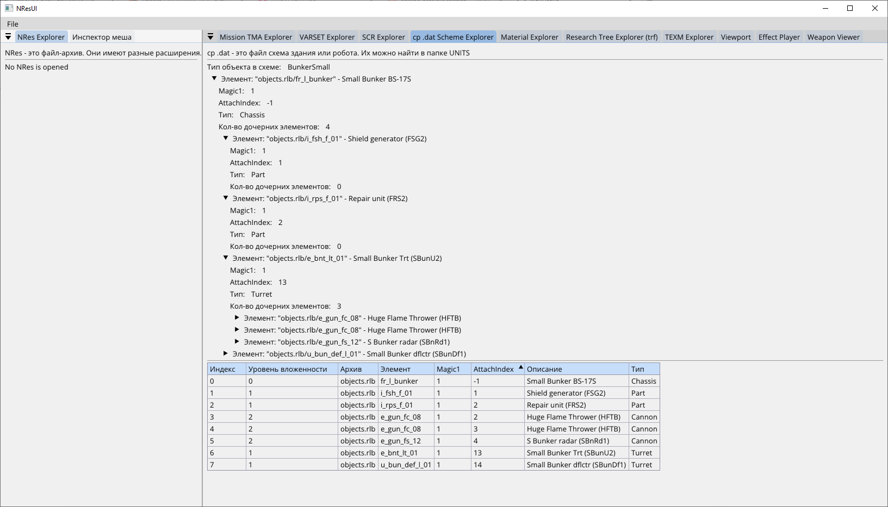
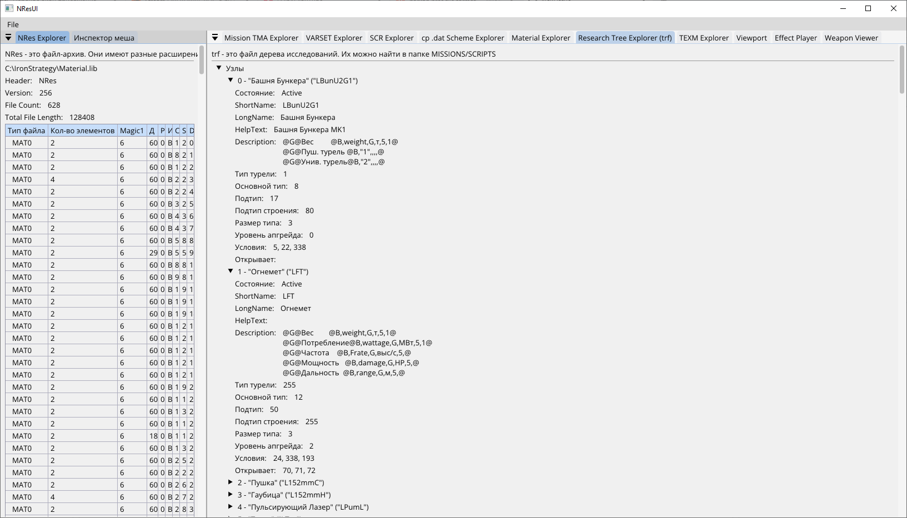

# NResUI: просмотр файлов игры

Графическое приложение (ImGui, OpenGL, .NET 9, кросс-платформенное) для просмотра форматов игры и проверки гипотез.

## Запуск

```shell
dotnet run --project NResUI -c Release
```

Приложение читает `config.json` из текущей папки (рабочей папки запуска); если файла нет, при первом старте он создаётся с пустым путём:

```json
{ "GameBasePath": "C:\\Program Files (x86)\\Nikita\\Iron Strategy" }
```

`GameBasePath` - папка игры (с `DATA`, `MISSIONS`, `UNITS`). Для проигрывателей эффектов нужны также распакованные архивы либо исходные `.rlb`/`.lib`
в этой папке. Звук воспроизводится только в Windows (`winmm`).

## Меню `File`

| Пункт | Что открывает |
|---|---|
| Open NRes | любой NRes-архив: список элементов, просмотр, экспорт |
| Open TEXM / Open TFNT TEXM | текстура / шрифтовая текстура |
| Open Mission TMA | файл миссии (`MissionTmaLib`) |
| Open SCR Scripts File | скрипты ИИ (`ScrLib`) |
| Open Areal Map (Land.map) | карта ареалов (`ArealMapLib`) |
| Open Varset File | переменные `.var` (`VarsetLib`) |
| Open cp .dat Scheme File | схема объекта (`CpDatLib`) |
| Open research .trf File | дерево исследований (`ResTreeLib`) |

## Панели

| Панель | Для чего | Документация |
|---|---|---|
| NRes Explorer | содержимое NRes-архива, просмотр и экспорт элементов | [NResLib](../NResLib/README.md) |
| Material Explorer | MAT0: стадии, анимации, режим смешивания, свойства поверхности | [MaterialLib](../MaterialLib/README.md) |
| Effect Player | воспроизведение одного эффекта FXID: таймлайн компонентов, режимы силы, камера, звук | [FxidLib](../FxidLib/README.md) |
| Weapon Viewer | выстрел целиком: орудие → снаряд → эффекты → взрыв; модель орудия, выбор стволов и поверхности | [ControlLib](../ControlLib/README.md), §7 |
| Инспектор меша / Viewport | меш MSH, поза и анимация | [MshLib](../MshLib/README.md) |
| SCR Explorer | скрипты ИИ: читаемый текст (формулы, имена переменных и функций, подсказки при наведении) и таблица инструкций | [ScrLib](../ScrLib/README.md) |
| Areal Map Explorer | карта ареалов: многоугольники, соседи, раскраска по маске/признаку/наклону, масштаб колесом, перетаскивание, выбор щелчком | [ArealMapLib](../ArealMapLib/README.md) |
| VARSET Explorer | переменные и константы скриптов | [VarsetLib](../VarsetLib/README.md) |
| TEXM Explorer | текстуры и страницы атласа | [TexmLib](../TexmLib/README.md) |
| Mission TMA Explorer | ареалы, кланы, объекты миссии | [MissionTmaLib](../MissionTmaLib/README.md) |
| cp .dat Scheme Explorer | дерево частей объекта | [CpDatLib](../CpDatLib/README.md) |
| Research Tree Explorer (trf) | узлы исследований и зависимости | [ResTreeLib](../ResTreeLib/README.md) |
| Binary Explorer | просмотр произвольных байтов | - |

## Скриншоты


*Effect Player: эффект `engine_mis_b`, окна активности компонентов и параметры вида*


*Weapon Viewer: выстрел орудия `o_gun_ba_21` - модель, вспышка, снаряд, взрыв*


*Material Explorer: материал `B_PG3` - поля MAT0 в порядке чтения из файла*


*SCR Explorer: секции скрипта ИИ, инструкции и названия встроенных функций*


*Viewport: здание (`43_fr_l_plant.msh`) с текстурами из набора материалов*


*Инспектор меша и Viewport: робот `6_MESH_R_L_03.msh`, дерево деталей, состояния и LOD*


*Mission TMA Explorer: ареалы, кланы и объекты миссии `data.tma`*


*VARSET Explorer: переменные и константы `MISSIONS/SCRIPTS/varset.var`*


*cp .dat Scheme Explorer: дерево частей малого бункера и таблица элементов*


*Research Tree Explorer: узлы дерева исследований, условия и что они открывают*


*TEXM Explorer: текстура `EFFECT5.0` с раскладкой атласа страниц*

