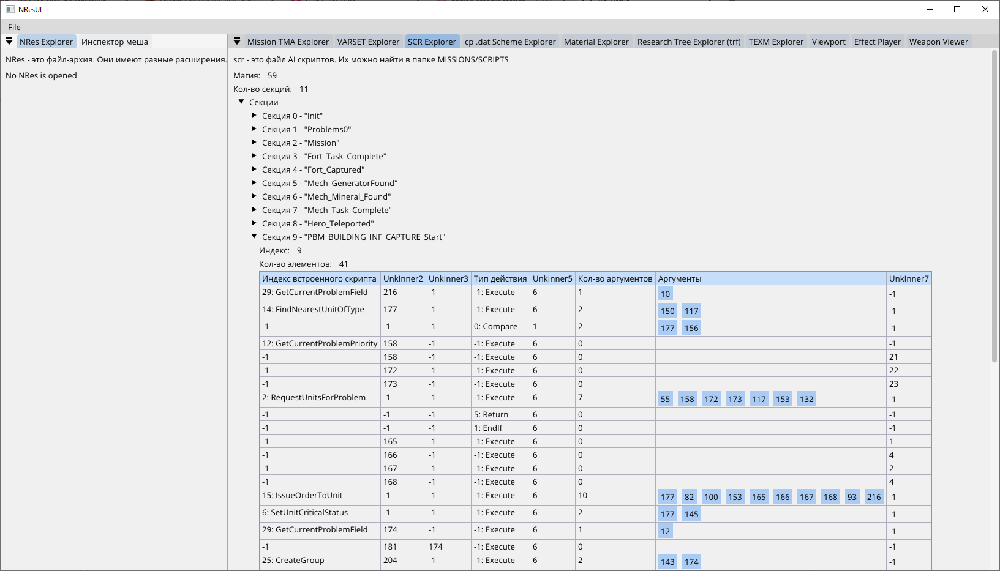

# Reverse Engineering игры Parkan Железная стратегия 1998

<div align="center">
  

  
</div>


## О проекте

Исследование формата данных и логики игры **Parkan: Iron Strategy** (1998) и набор C#-инструментов для её файлов. Результаты хранятся в трёх местах:

- **XML-комментарии библиотек** - описание полей и значений со статистикой по файлам игры (где значение встречается и сколько раз);
- **README библиотек** - как игра использует формат, цепочки вызовов, что проверено и что нет;
- **проект Ghidra** - имена и типы в `Control.dll`, `World3D.dll`, `Effect.dll`, `AniMesh.dll`, `Terrain.dll`, `Behavior.dll`, `ai.dll` и других.

Статус утверждений в документах: **проверено** (по коду и данным), **гипотеза** (данные согласуются, кода нет), **не выяснено**.

## С чего начать

| Хочу ... | Смотрю |
|---|---|
| понять, как игра устроена в целом | разделы «Как работает игра» и «Внутренняя система ID» ниже |
| разобрать формат файла | таблица библиотек ниже: у каждой есть README и XML-комментарии |
| увидеть данные игры глазами | [NResUI](NResUI/README.md): панели просмотра NRes, материалов, эффектов, оружия, скриптов |
| разобраться в оружии и эффектах выстрела | [ControlLib/README.md](ControlLib/README.md), §7; [FxidLib/README.md](FxidLib/README.md) |
| разобраться в ИИ и скриптах миссий | [ScrLib/README.md](ScrLib/README.md) |
| продолжить реверс | «Не выяснено» и «Чего нет в данных» в README [ControlLib](ControlLib/README.md) и [MaterialLib](MaterialLib/README.md); [глоссарий](docs/GLOSSARY.md) |

## Как это выглядит

Панели приложения [NResUI](NResUI/README.md) (все скриншоты - в его README):


*Effect Player: эффект `engine_mis_b`, окна активности компонентов и параметры вида*


*Weapon Viewer: выстрел орудия `o_gun_ba_21` - модель, вспышка, снаряд, взрыв*


*Инспектор меша и Viewport: робот `6_MESH_R_L_03.msh`, дерево деталей, состояния и LOD*


*SCR Explorer: секции скрипта ИИ, инструкции и названия встроенных функций*

## Сборка проекта

Проект написан на C# под `.NET 9`. Достаточно `dotnet build ParkanPlayground.slnx` для сборки всех проектов; приложения кросс-платформенные, включая UI.

Графическое приложение: `dotnet run --project NResUI -c Release` (нужен `config.json` с путём к игре - см. [NResUI/README.md](NResUI/README.md)).

## Карта библиотек

| Проект | Что разбирает | Документация |
|---|---|---|
| [`NResLib`](NResLib/README.md) | NRes-архивы (`.lib`, `.rlb`, карты): элементы, метаданные | README |
| [`RsLiLib`](RsLiLib/README.md) | NL-архивы (`gamefont.rlb`, `sprites.lib`): шифр таблицы, LZSS, deflate | README |
| [`Common`](Common/README.md) | чтение бинарных данных, `Vector3`, `ResourceNamedRef` | README |
| [`MshLib`](MshLib/README.md) | меши MSH: узлы, вершины, треугольники, батчи, анимация | README, `docs/` |
| [`TexmLib`](TexmLib/README.md) | текстуры TEXM и страницы атласа | README |
| [`PalLib`](PalLib/README.md) | палитры PAL | README |
| [`MaterialLib`](MaterialLib/README.md) | материалы MAT0, менеджер материалов | README |
| [`WeaLib`](WeaLib/README.md) | наборы материалов `.wea` | README |
| [`FxidLib`](FxidLib/README.md) | эффекты FXID | README |
| [`ExplLib`](ExplLib/README.md) | описание взрыва EXPL | README |
| [`ControlLib`](ControlLib/README.md) | управление объектом: CTL, CPT, NDP, записи агентов, предметы, оружие | README |
| [`CpDatLib`](CpDatLib/README.md) | схемы объектов `.dat` | README |
| [`ArealMapLib`](ArealMapLib/README.md) | карта ареалов `Land.map`: многоугольники проходимости, соседи, сетка ячеек | README |
| [`BasLib`](BasLib/README.md) | контуры оснований зданий `.bas` | README |
| [`SkeLib`](SkeLib/README.md) | расписание атмосферы `sky.ske` | README |
| [`MissionTmaLib`](MissionTmaLib/README.md) | файл миссии `.tma` | README |
| [`ResTreeLib`](ResTreeLib/README.md) | дерево исследований `.trf` | README |
| [`ScrLib`](ScrLib/README.md) | скрипты ИИ `.scr`, формулы `.fml`, текстовые дампы | README, [`docs/scripts`](docs/scripts/README.md) |
| [`VarsetLib`](VarsetLib/README.md) | переменные `.var` | README |
| [`NResUI`](NResUI/README.md) | приложение для просмотра и проверки гипотез | README |
| [`ParkanPlayground`](ParkanPlayground/README.md) | песочница для проверок и дампов | README |
| [`NLUnpacker`](NLUnpacker/README.md) | заготовка распаковки NL-архива | README |

### Что поддерживается

- Все `NRes` файлы: звуки, музыка, текстуры, карты и другие.
- Текстуры `TEXM`, шрифты `TFNT`.
- Файлы миссий `.tma`, скрипты `.scr`/`.fml`, файлы параметров `.var`, схемы объектов `.dat`, деревья исследований `.trf`.
- Материалы, эффекты FXID, управление объектами (CTL/CPT/NDP), меши MSH, атмосфера `sky.ske`.

### Примечание об устройстве проекта

Проект делается как небольшой PET-проект, поэтому часть названий и структуры может быть непоследовательной; чем старее код, тем вероятнее расхождения.
Актуальное описание форматов - в XML-комментариях и README библиотек, глоссарий - [docs/GLOSSARY.md](docs/GLOSSARY.md).

## Для Reverse Engineering-а использую Ghidra

### Наблюдения 

- Игра использует множество стандартных библиотек, в частности stl_port, vc++6 и другие. Если хотите что-то изучить в игре, стоит поискать по строкам и сигнатурам, что именно используется в конкретной `dll`.
- Строки в основном используются двух форматов - `char*` и `std::string`. Последняя состоит из 16 байт - `undefined4, char* data, int length, int capacity`.
- В игре очень много `inline` функции, которые повторяются по куче раз в бинарнике. 
- Игра загружает и выгружает свои `dll` файлы по несколько раз, так что дебаг с `Memory Map` очень затруднён.
- Игра активно и обильно течёт по памяти, оставляя после чтения файлов их `MapViewOfFile` и подобные штуки.
- Игра нормально не работает на Win10. Мне помог dgVoodoo. Хотя с ним не работает `MisEditor`.

## Как быстро найти текст среди всех файлов игры

```shell
grep -rl --include="*" "s_tree_05" .
```

## Как быстро найти байты среди всех файлов игры

```shell
grep -rlU $'\x73\x5f\x74\x72\x65\x65\x5f\x30\x35' .
```

## Как работает игра

Главное меню:

Игра сканирует хардкод папку `missions` на наличие файлов миссий. (буквально 01, 02, 03 и т.д.)

Сначала игра читает название миссии из файла `descr` - тут название для меню.

- Одиночные игры - `missions/single.{index}/descr`
- Тренировочные миссии - `missions/tutorial.{index}/descr`
- Кампания - `missions/campaign/campaign.{index1}/descr`
  * Далее используются подпапки - `missions/campaign/campaign.{index1}/mission.{index2}/descr`

Как только игра не находит файл `descr`, заканчивается итерация по папкам (понял, т.к. пробуется файл 05 - он не существует).

Загрузка миссии:

Читается файл `ui/game_resources.cfg` (формат и виды ресурсов - [docs/SERVICES.md](docs/SERVICES.md))
Из этого файла загружаются ресурсы
- `library = "ui\\ui.lib"` - загружается файл `ui.lib`
- `library = "ui\\font.lib"` - загружается файл `font.lib`
- `library = "sounds.lib"` - загружается файл `sounds.lib`
- `library = "voices.lib"` - загружается файл `voices.lib`

Затем игра читает `save/saveslots.cfg` - тут слоты сохранения

Затем `Comp.ini` - тут системные функции, которые используются для загрузки объектов.

```
IComponent ** LoadSomething(undefined4, undefined4, undefined4, undefined4)
```

- `Host.url` - этого файла нет
- `palettes.lib` - тут палитры, но этот NRes пустой
- `system.rlb` - не понятно что
- `Textures.lib` - тут текстуры
- `Material.lib` - тут какие-то материалы - не понятно
- `LightMap.lib` - видимо это карты освещения - не понятно
- `sys.lib` - не понятно


- `ScanCode.dsc` - текстовый файл с мапом клавиш
- `command.dsc` - текстовый файл с мапом клавиш

Тут видимо идёт конфигурация ввода

- `table_1.man` - текстовый файл
- `table_2.man` - текстовый файл
- `hero.man` - текстовый файл
- `addition.man` - текстовый файл
- Снова `table_1.man`
- Снова `table_1.man`
- `M1.tbl` - текстовый файл
- Снова `table_2.man`
- Снова `table_2.man`
- `M2.tbl` - текстовый файл
- Снова `hero.man`
- Снова `hero.man`
- `HERO.TBL`
- Снова `addition.man`


- `ui/hq.cfg`
- Снова `ui/hq.cfg`


Дальше непосредственно читается миссия

- `mission.cfg` - метадата миссии
- `units\\units\\prebld\\scr_pre1.dat` из метаданных `object prebuild` - `cp` файл (грузятся подряд все)
- Опять `ui/hq.cfg`
- `mistips.mis` - описание для игрока (экран F1)
- `scancode.dsc` - хз
- `command.dsc` - хз
- `ui_hero.man` - хз
- `ui_bots.man` - хз
- `ui_hq.man` - хз
- `ui_other.man` - хз
- Цикл чтения курсоров
  * `ui/cursor.cfg` - тут настройки курсора.
  * `ui/{name}` - курсор
- Снова `mission.cfg` - метадата миссии
- `descr` - название
- `data/textres.cfg` - конфиг текстов
- Снова `mission.cfg` - метадата миссии
- Ещё раз `mission.cfg` - метадата миссии
- `ui/minimap.lib` - NRes с текстурами миникарты. 
- `messages.cfg` - Tutorial messages

УРА НАКОНЕЦ-ТО `data.tma`

- Из `.tma` берётся LAND строка (я её так назвал)
- `DATA\\MAPS\\SC_3\\land1.wea`
- `DATA\\MAPS\\SC_3\\land2.wea`
- `BuildDat.lst` - Behaviour will use these schemes to Build Fortification
- `DATA\\MAPS\\SC_3\\land.map`
- `DATA\\MAPS\\SC_3\\land.msh`


- `effects.rlb`

Цикл по кланам из `.tma`
- `MISSIONS\\SCRIPTS\\screampl.scr`
- `varset.var`
- `MISSIONS\\SCRIPTS\\varset.var`
- `MISSIONS\\SCRIPTS\\screampl.fml`


- `missions/single.01/sky.ske`
- `missions/single.01/sky.wea`

Дальше начинаются объекты игры
- `"UNITS\\BUILDS\\BUNKER\\mbunk01.dat"` - cp файл

## Загрузка `cp` файлов

Схема объекта (`.dat`), таблица загрузчиков по Logic ID и запись `fr FORT`: [CpDatLib/README.md](CpDatLib/README.md).

## `.msh`

### Описание ниже валидно только для моделей роботов и зданий.
##### Land.msh использует другой формат, хотя 03 файл это всё ещё точки.

Загружается в `AniMesh.dll/LoadAniMesh`

- Тип 01 - заголовок. Он хранит список деталей (submesh) в разных LOD
  ```
  нулевому элементу добавляется флаг 0x1000000
  Содержит 2 ссылки на анимационные subentry: AnimMapStart указывает в файл 0x13, FallbackKey указывает в файл 0x08.
  Если интерполируется анимация -0.5s короче чем magic1 у файла 13
  И у файла есть OffsetIntoFile13
  И ushort значение в файле 13 по этому оффсету > IndexInFile08 (это по-моему выполняется всегда)
  Тогда вместо IndexInFile08 используется значение из файла 13 по этому оффсету (второй байт)
  ```
- Тип 02 - описание одного LOD Submesh
  ```
  Вначале идёт заголовок 0x8C (140) байт
  В заголовке:
  8 Vector3 (x,y,z) - bounding box
  1 Vector4 - center
  1 Vector3 - bottom
  1 Vector3 - top
  1 float - xy_radius
  Далее инфа про куски меша
  ```
- Тип 03 - это вершины (vertex)
- Тип 06 - индексы треугольников в файле 03
- Тип 04 - скорее всего какие-то цвета RGBA или типа того
- Тип 08 - меш-анимации (см файл 01)
  ```
  Индексируется по IndexInFile08 из файла 01 либо по файлу 13 через OffsetIntoFile13
  Структура:
  Vector3 position;
  float time; // содержит только целые секунды
  short rotation_x; // делится на 32767
  short rotation_y; // делится на 32767
  short rotation_z; // делится на 32767
  short rotation_w; // делится на 32767
  ---
  Игра интерполирует анимацию между текущим стейтом и следующим по time.
  Если время интерполяции совпадает с исходным time, жёстко берётся первый стейт из 0x13.
  Если время интерполяции совпадает с конечным time, жёстко берётся второй стейт из 0x13.
  Если ни то и ни другое, тогда t = (time - souce.time) / (dest.time - source.time)
  ```
- Тип 12 - microtexture mapping
- Тип 13 - animation map / карта кадров для выбора ключей из файла 08
  ```
  Буквально (hex)
  00 01 01 02 ...
  ```
- Тип 0A - ссылка на части меша, не упакованные в текущий меш (например у бункера 4 и 5 части хранятся в parts.rlb)
  ```
  Не имеет фиксированной длины. Хранит строки в следующем формате.
  Игра обращается по индексу, пропуская суммарную длину и пропуская 4 байта на каждую строку (длина).
  т.е. буквально файл выглядит так
  00 00 00 00 - пустая строка
  03 00 00 00 - длина строки 1
  73 74 72 00 - строка "str" + null terminator
  .. и повторяется до конца файла
  Кол-во элементов из файла 01 должно быть равно кол-ву строк в этом файле, хотя игра это не проверяет.
  Если у элемента эта строка равна "central", ему выставляется флаг (flag |= 1)
  ```

## `.wea`

Таблица материалов и карт освещения: [WeaLib/README.md](WeaLib/README.md), поведение менеджера материалов - [MaterialLib/README.md](MaterialLib/README.md).

## `.bas Basement` файл

Контуры основания здания: формат и использование - [BasLib/README.md](BasLib/README.md).

## Lightmap (TEXM)

Карты освещения - те же TEXM-текстуры со специальными именами: [TexmLib/README.md](TexmLib/README.md).

## `FXID` - файл эффектов

Заголовок 0x3C + компоненты 10 типов (свет, 3D-звук, анимированные объекты, след, частицы, спавнер). Рантайм - `Effect.dll` (FxManager, EffectHandle, IEffect).
Полное описание формата, флагов, `SettingsId`, LOD, `stateFlags` и неразобранных мест: [FxidLib/README.md](FxidLib/README.md).

# ЕСЛИ ГДЕ-ТО ВИДИШЬ PTR_func_ret1_no_args, ТО ЭТО ShaderConfig

# Внутренняя система ID

- `1` - unknown (implemented by CLandscape) видимо ILandscape (очень похоже на legacy IMesh судя по vtable)
- `3` - unknown (implemented by CAtmosphere) видимо IAtmosphere
- `4` - IShader
- `5` - ITerrain
- `6` - IGameObject
- `7` - IGameSettingsProvider
- `8` - ICamera
- `9` - IQueue
- `10` - IControl
- `0xb` - IAnimation
- `0xc` - IShadeStatsBuilder (придумал сам implemented by CShade)
- `0xd` - IMatManager
- `0xe` - ILightManager
- `0xf` - IShade
- `0x10` - IBehaviour
- `0x11` - IBasement
- `0x12` - ICamera2 или IBufferingCamera
- `0x13` - IEffectManager
- `0x14` - IPosition
- `0x15` - IAgent
- `0x16` - ILifeSystem
- `0x17` - IBuilding - точно он, т.к. ArealMap.CreateObject на него проверяет
- `0x18` - IMesh2
- `0x19` - IManManager
- `0x20` - IJointMesh
- `0x21` - IShadowProcessor (придумал сам implemented by CShade)
- `0x22` - unknown (implement by CLandscape) (похоже на ITopProvider т.к. в vtable только GetTopQuad)
- `0x23` - IGameSettingsRoot
- `0x24` - IGameObject2
- `0x25` - ICollisionMesh (придумал сам implemented by CAniMesh)
- `0x26` - INetSerializable (придумал сам implemented by CAniMesh and CControl and CWizard)
- `0x28` - ICollObject
- `0x29` - IPhysicalModel
- `0x101` - I3DRender
- `0x102` - ITexture (writable)
- `0x103` - IColorLookup
- `0x104` - IBitmapFont
- `0x105` - INResFile
- `0x106` - NResFileMetadata
- `0x107` - I3DSound
- `0x108` - IListenerTransform
- `0x109` - ISoundPool
- `0x10a` - ISoundBuffer
- `0x10c` - ICDPlayer
- `0x10d` - IVertexBuffer
- `0x201` - IWizard
- `0x202` - IItemManager
- `0x203` - ICollManager
- `0x301` - IArealMap
- `0x302` - ISystemArealMap
- `0x303` - IHallway
- `0x304` - IDistributor
- `0x401` - ISuperAI
- `0x501` - MissionData
- `0x502` - ResTree
- `0x700` - INetWatcher
- `0x701` - INetworkInterface
- `0x802` - INetSessionBrowser (придумал сам implemented by CNetManager in services.dll)
- `0x803` - INetManager

## SuperAI = Clan с точки зрения индексации

Т.е. у каждого клана свой SuperAI

## Опции

World3D.dll содержит singleton Registry в CreateGameSettings.
Она создаёт объект настроек и далее вызывает методы в соседних библиотеках.
- Terrain.dll - InitializeSettings
- Effect.dll - InitializeSettings
- Control.dll - InitializeSettings

Остальные наверное не трогают настройки.

| Resource ID |    wOptionID    |            Name            | Default | Description        |
|:-----------:|:---------------:|:--------------------------:|:-------:|--------------------|
|      1      |   100 (0x64)    |      "Texture detail"      |         |                    |
|      2      |   101 (0x65)    |         "3D Sound"         |         |                    |
|      3      |   102 (0x66)    |    "Mouse sensitivity"     |         |                    |
|      4      |   103 (0x67)    |   "Joystick sensitivity"   |         |                    |
|      5      | !not a setting! |    "Illegal wOptionID"     |         |                    |
|      6      |   104 (0x68)    |     "Wait for retrace"     |         |                    |
|      7      |   105 (0x69)    |     "Inverse mouse X"      |         |                    |
|      8      |   106 (0x6a)    |     "Inverse mouse Y"      |         |                    |
|      9      |   107 (0x6b)    |    "Inverse joystick X"    |         |                    |
|     10      |   108 (0x6c)    |    "Inverse joystick Y"    |         |                    |
|     11      |   109 (0x6d)    |     "Use BumpMapping"      |         |                    |
|     12      |   110 (0x6e)    |     "3D Sound quality"     |         |                    |
|     13      |    90 (0x5a)    |      "Reverse sound"       |         |                    |
|     14      |    91 (0x5b)    |  "Sound buffer frequency"  |         |                    |
|     15      |    92 (0x5c)    | "Play sound buffer always" |         |                    |
|     16      |    93 (0x5d)    | "Select best sound device" |         |                    |
|    ----     |    30 (0x1e)    |        ShadeConfig         |         | из файла shade.cfg |
|    ----     |    (0x8001e)    |                            |         | добавляет AniMesh  |

## Terrain primitive RE

Primitive layer types:
0: PrimLayer0
Stores PrimLayerElement0 { primitive, vb_descriptor, key0, key1 }.
Sorts by dynamic vertex-buffer descriptor and stream/layout keys,
then calls primitive->Render in grouped order.

1: PrimLayer1
Stores PrimLayerElement1 { primitive, distance_key }.
Inserts by descending distance from sort_origin.
Calls primitive->Render in stored order.

2: PrimLayer2
Stores IPrimitive* only.
Alpha-filters and appends.
Calls primitive->Render in insertion order.

3: CCamDistSortLayer / PrimLayer3
Stores PrimLayerElement1 { primitive, distance_key }.
Inserts by descending distance from sort_origin.
Does not call primitive->Render; merges primitives into batched dynamic-VB draws.

4: illegal.

5: PrimLayer5
Same primitive pointer list style as PrimLayer2.
Renders only when UseReflections is enabled and clears Z before render.

## Network GMSG commands (not complete)

_элементы с _ не до конца понятны_

```
typedef enum E_GMSG_COMMAND {
  GMSG_NEW_GAME_TICK = 1,
  GMSG_INIT = 4,
  GMSG_END_MESSAGE_SEQ = 6,
  _GMSG_SET_STATE = 7,
  _GMSG_REMOVE_RESOURCE = 0x14,
  _GMSG_AFTER_DETACHED = 0x15,
  GMSG_KILL_GAMEOBJECT = 0x16,
  _SomeEnvironmentToggleON = 0x17,
  _SomeEnvironmentToggleOFF = 0x18,
  _Unknown_Command_0x19 = 0x19,
  GMSG_COLLISION_DETECTED = 0x1B,
  GMSG_FRAME_UPDATE = 0x1C,
  _SHOW_AREALS = 0x67,
  _GMSG_PAUSE_REMOTE_PLAYER = 0x3EA,
  GMSG_CONFIRM_PLAYER_DATA = 0x3EC,
  GMSG_KILL_PLAYER = 0x3ED,
  GMSG_GET_SAVEGAME_FROM_HOST = 0x3EE,
  GMSG_SET_GAME_STARTED = 0x3EF,
  GMSG_DETACH_CHILD_FROM_PARENT = 0x3F1,
  GMSG_ADD_LANDSCAPE_CHILD = 0x3F2,
  GMSG_CREATE_MIRROR = 0x80000000,
  GMSG_CREATE_REMOTE_PLAYER = 0x80000001,
  GMSG_TEXT_FOR_PLAYER = 0x80000002,
  GMSG_SYNC_OBJECT_STATE = 0x80000003,
  GMSG_TAKE_OBJECT = 0x80000004,
  GMSG_MISSION_DATA_PATH = 0x80000005,
  GMSG_SET_PLAYER_DATA = 0x80000006,
  GMSG_CHANGE_OBJECT_OWNER = 0x80000007,
  GMSG_APPEND_RESOURCE = 0x80000020,
  GMSG_INVALID = 0xFFFFFFFF,
} E_GMSG_COMMAND;
```

## Контакты

Вы можете связаться со мной в [Telegram](https://t.me/bird_egop).
